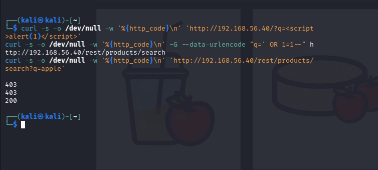
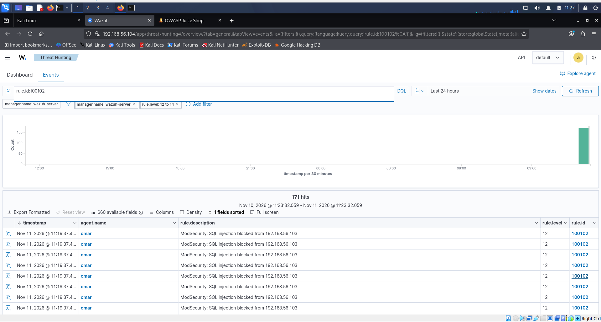
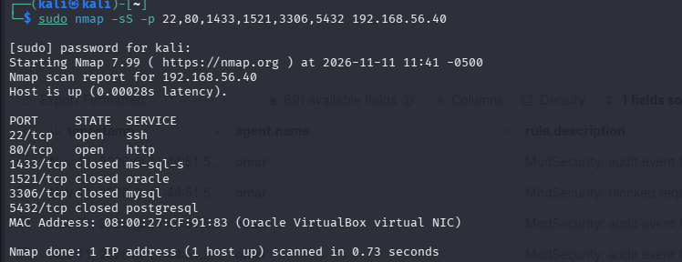
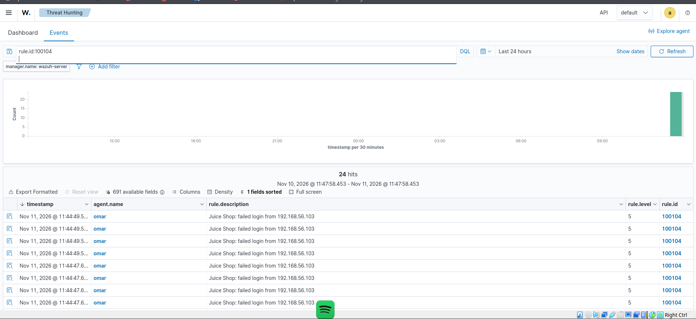
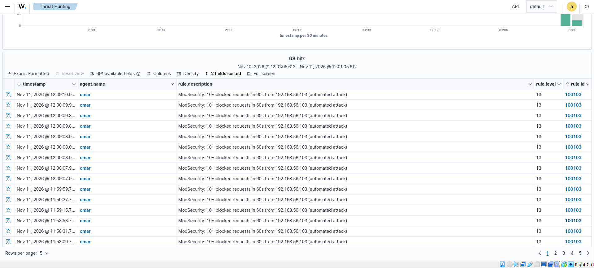
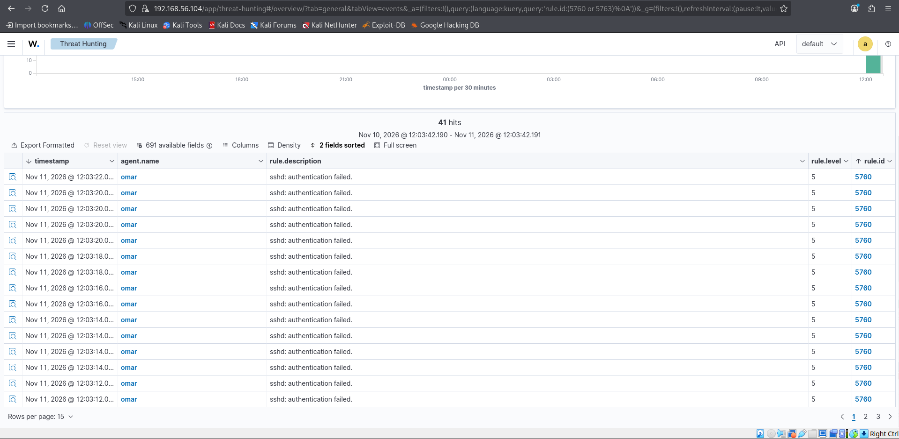
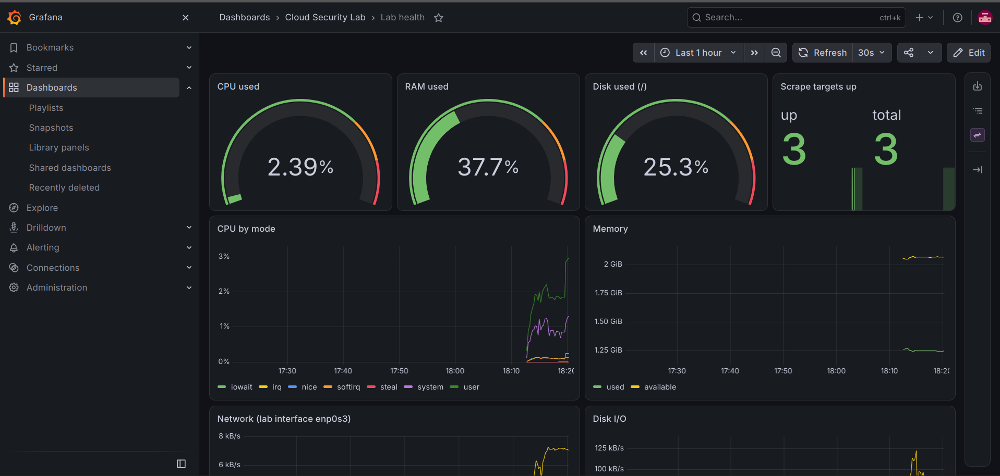
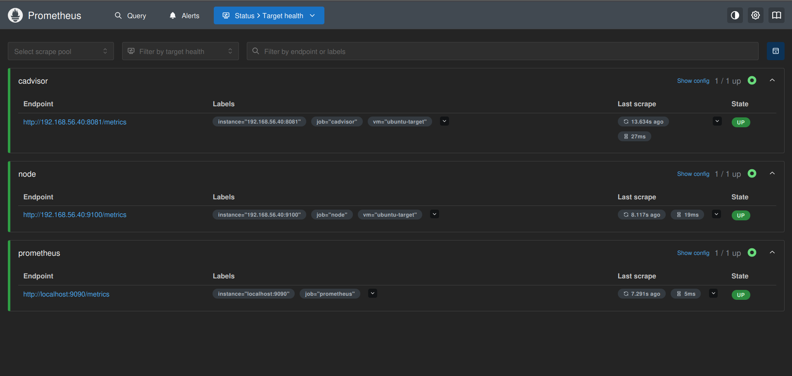
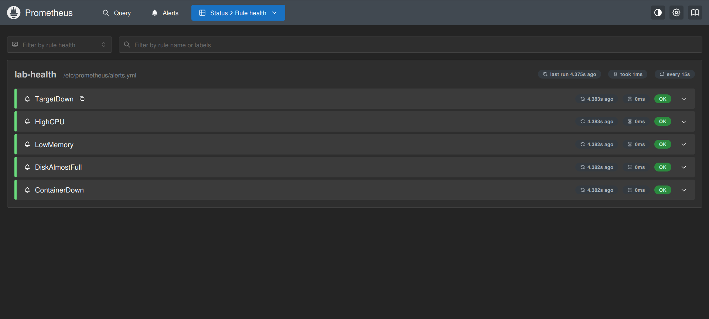

# Self-hosted Cloud + Security Lab

Attack it, watch it, detect it, block it, learn. Full architecture: [docs/cloud-security-lab.pdf](docs/cloud-security-lab.pdf).

| Folder | Contents |
|---|---|
| `infra/` | Docker Compose, NGINX + ModSecurity (OWASP CRS), Juice Shop / DVWA, nftables, Terraform |
| `detection/` | Wazuh config and custom rules, Suricata (ET Open) |
| `soar/` | Shuffle workflows, Wazuh Active Response |
| `monitoring/` | Prometheus, node_exporter, cAdvisor, Grafana dashboards |
| `ml/` | FastAPI scoring service, scikit-learn models, MLflow retraining |
| `docs/` | Architecture and notes |

## Build order
1. **Lab base**: Compose + Wazuh up ✅
2. **Signatures**: CRS + Suricata rules ✅
3. **Health**: Prometheus, Grafana ✅
4. **SOAR**: Shuffle blocks IPs
5. **ML loop**: train, score, retrain
6. **DevSecOps**: CI scans, Terraform

## Lab

| VM | IP | Role |
|---|---|---|
| Kali | 192.168.56.103 | Attacker |
| Ubuntu-Target (Ubuntu 26.04) | 192.168.56.40 | Juice Shop behind NGINX + ModSecurity (CRS 4), Wazuh agent |
| Wazuh 4.14.10 (OVA) | 192.168.56.104 | Manager, indexer, dashboard |

All on a VirtualBox host-only network. Setup steps: [docs/phase1-lab-base.md](docs/phase1-lab-base.md).

## Phase 1: attack → block → alert

Normal traffic reaches Juice Shop through the WAF:

XSS and SQL injection from Kali are blocked with 403; a normal search still returns 200:

sqlmap finds nothing injectable: 89 of its requests were blocked by the WAF:

The Wazuh agent ships the WAF's JSON audit log, and custom rules ([detection/wazuh/local_rules.xml](detection/wazuh/local_rules.xml)) raise level-12 alerts with the attacker's IP and MITRE T1190:

| Rule | Level | Fires on |
|---|---|---|
| 100100 | 3 | Any ModSecurity audit event |
| 100101 | 10 | Request blocked (403) |
| 100102 | 12 | SQL injection blocked (CRS 942xxx) |

## Phase 2: signatures (network IDS + correlation)

Suricata 8 with the ET Open ruleset (~53k signatures) watches the lab network, and new Wazuh rules correlate repeated events into one high-severity alert. Setup and tests: [docs/phase2-signatures.md](docs/phase2-signatures.md).

A port scan from Kali raises scan alerts, then a single level-12 "port scan" once 4+ fire in 60s:

Repeated failed Juice Shop logins (level 5), which aggregate into a level-12 brute-force alert:

nikto trips the WAF repeatedly, raising a level-13 "automated attack" alert:

SSH brute force (hydra) caught by Wazuh's built-in sshd rules:

| Rule | Level | Fires on |
|---|---|---|
| 100103 | 13 | 10+ WAF blocks in 60s from one IP (sqlmap, nikto) |
| 100104 / 100105 | 5 / 12 | Failed login / 10+ failures in 60s (brute force) |
| 100110 / 100111 | 8 / 12 | Scan signature / 4+ scan alerts in 60s (port scan) |
| 5760 / 5763 | 5 / 10 | sshd failed login / SSH brute force (built-in) |

## Phase 3: health and usage monitoring

node_exporter and cAdvisor on the target expose host and per-container metrics; Prometheus scrapes them every 15s and Grafana shows them on a provisioned "Lab health" dashboard. Setup: [docs/phase3-health.md](docs/phase3-health.md).

All scrape targets up:

Five alert rules (exporter down, high CPU, low memory, disk almost full, app container down). `TargetDown` was tested by stopping cAdvisor: it fired after a minute and cleared on restart.

CPU uses busy ÷ total time rather than `100 - idle`: on this VirtualBox guest the CPU counters undercount, and the usual formula showed 50-80% for a VM that `top` showed at 2-4%.

> Keep the lab on an isolated network. Only attack systems you own. Plan for ~16 GB RAM (Wazuh alone needs ~8 GB).
